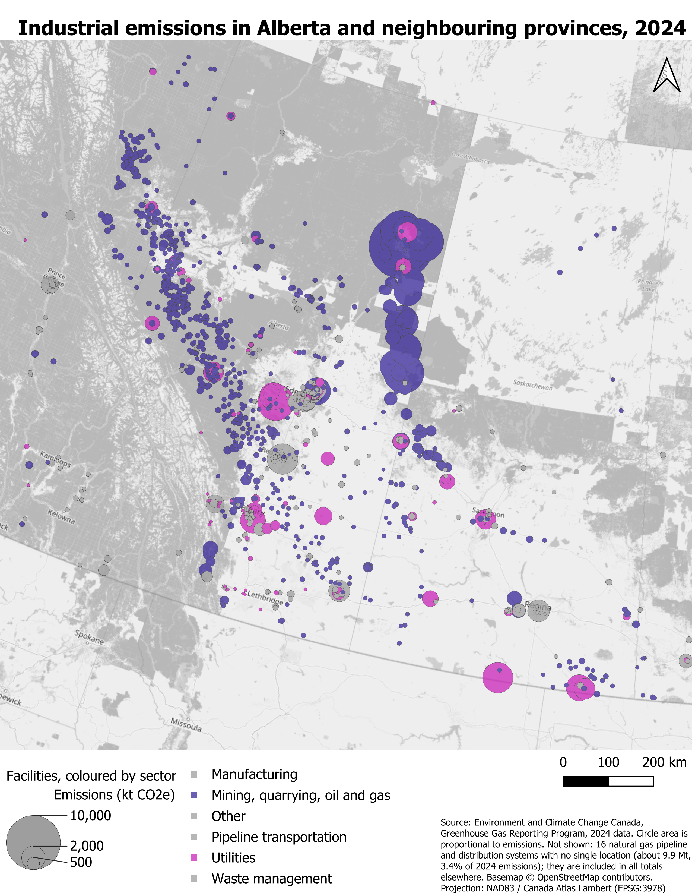
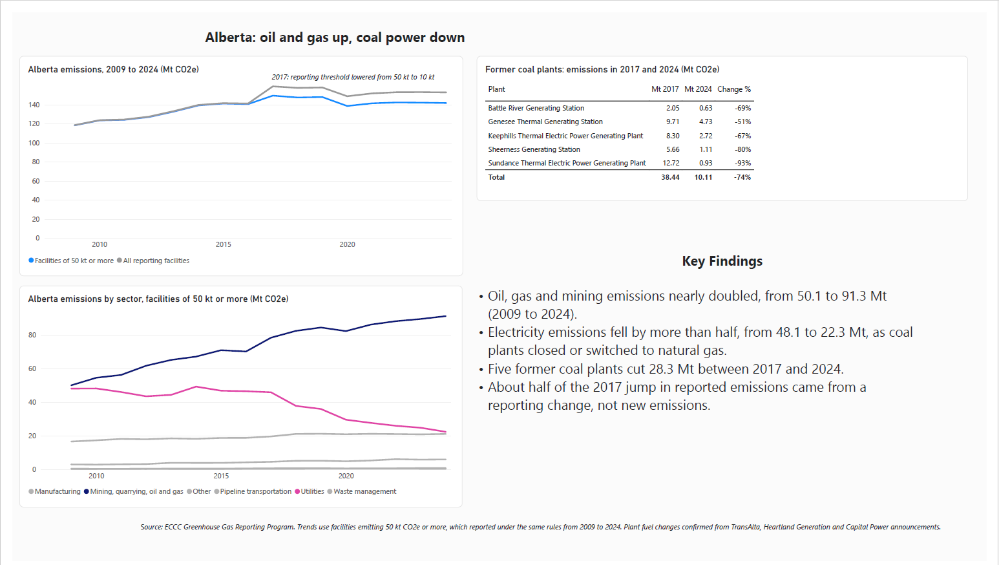

# Alberta's Industrial Emissions, 2009 to 2024

Alberta's large industrial facilities emitted 20% more in 2024 than in 2009, but that total hides two opposite trends. Oil, gas and mining emissions nearly doubled, while electricity emissions fell by more than half as five coal plants closed or switched to natural gas.

I built this project with Canada's facility-level emissions data, using SQL to clean and analyze it, Power BI for a dashboard, and QGIS for a map. Every number was checked against Environment and Climate Change Canada's published figures and across all three tools.

## Key findings

| Measure (Alberta, facilities of 50 kt CO2e or more) | 2009 | 2024 | Change |
| --- | --- | --- | --- |
| All large facilities | 118.2 Mt | 141.6 Mt | +20% |
| Oil, gas and mining | 50.1 Mt | 91.3 Mt | +82% |
| Utilities, mainly electricity | 48.1 Mt | 22.3 Mt | −54% |

- **Alberta dominates.** It produced 152.7 of the 291.7 Mt reported by Canada's large facilities in 2024 (52.4%).
- **Since 2017, all of Alberta's decline came from electricity.** Utilities fell 23.6 Mt; oil, gas and mining rose 12.8 Mt.
- **Five former coal plants cut 28.3 Mt.** Sundance, Genesee, Keephills, Sheerness and Battle River emitted 38.44 Mt in 2017 and 10.11 Mt in 2024. New natural gas plants, led by Cascade near Edson, added 2.79 Mt.
- **A few sites emit almost everything.** In 2024, 220 of Alberta's 769 reporting facilities produced 93% of its reported emissions.
- **The 2017 jump was half a counting effect.** Reported emissions rose 18.0 Mt that year, but 9.1 Mt came from smaller facilities that only began reporting when the threshold dropped from 50 kt to 10 kt.
- **Saskatchewan is going the other way.** Its three coal plants still emitted 7.4 Mt in 2024, and the province plans to run coal past the federal 2030 deadline.

Read the full two-page brief: [alberta_emissions_brief.pdf](brief/alberta_emissions_brief.pdf)

## Dashboard

A two-page Power BI dashboard: a national overview, then Alberta's trends by sector and the five former coal plants.

- [Dashboard as PDF](powerbi/alberta_emissions_dashboard.pdf)
- [Power BI file](powerbi/alberta_emissions.pbix) (open it in the free Power BI Desktop to explore the numbers)

## How I built it

1. **Loaded and cleaned the data in SQL.** Imported 20,685 facility-years into SQLite, kept the raw table untouched, and built a clean table with short column names. Public contact details were left out on purpose.
2. **Checked the data before using it.**
   - Facility counts and totals match ECCC's published figures (1,879 facilities and 291.7 Mt in 2024).
   - Every record's total equals the sum of its six gases.
   - Sector shares rebuilt from industry codes match ECCC's official 43%, 29% and 20%.
   - One record missing a province was filled from the facility's other 20 years.
3. **Handled the reporting threshold.** The threshold fell from 100 kt to 50 kt in 2009 and to 10 kt in 2017, which tripled the number of reporting facilities. To compare years fairly, trends use only facilities of 50 kt or more from 2009.
4. **Built the dashboard and map from SQL views**, so the sector grouping and the 50 kt rule are defined once and reused.
5. **Confirmed the story with outside sources.** Company announcements and news reports confirm each coal plant's closure or switch to gas.

## Repository contents

| Folder | Contents |
| --- | --- |
| `sql/` | Four scripts, run in order: clean table, data quality checks, analysis, and export views. Each query has a comment explaining what it does and what it returned. |
| `powerbi/` | Dashboard file, PDF export and page screenshots |
| `maps/` | QGIS project, map exports, and the map data (`map_2024.csv`) |
| `brief/` | The two-page written brief |

## Reproduce it

1. Download the facility emissions data from the [Open Government Portal](https://open.canada.ca/data/en/dataset/a8ba14b7-7f23-462a-bdbb-83b0ef629823): `PDGES-GHGRP-GHGEmissionsGES-2004-Present.csv`.
2. In [DB Browser for SQLite](https://sqlitebrowser.org), import it as a table named `raw_emissions_by_gas` (UTF-8, column names in first line).
3. Run the scripts in `sql/` in order, pressing Write Changes after each.
4. Export the `powerbi_export` and `map_2024` views to CSV to feed Power BI and QGIS.

## Limitations

- **Large facilities only.** The data covers facilities emitting 10 kt CO2e or more, about 44% of Canada's total emissions. It excludes vehicles, buildings and most farms.
- **Direct emissions only**, close to corporate Scope 1. No purchased electricity or supply chain.
- **Zero-emission power is invisible.** Wind and solar farms emit nothing, so the data cannot show how much of the lost coal power came from renewables.
- **Missing locations.** In 2024, 16 natural gas pipeline and distribution systems (3.4% of emissions) had no single location. They are left off the map and included in every total.

## Data source

Environment and Climate Change Canada, [Greenhouse Gas Reporting Program, Emissions Data by Facility](https://open.canada.ca/data/en/dataset/a8ba14b7-7f23-462a-bdbb-83b0ef629823), data current as of October 2, 2025. Plant-level sources are listed in the brief.

Map basemap © OpenStreetMap contributors.
